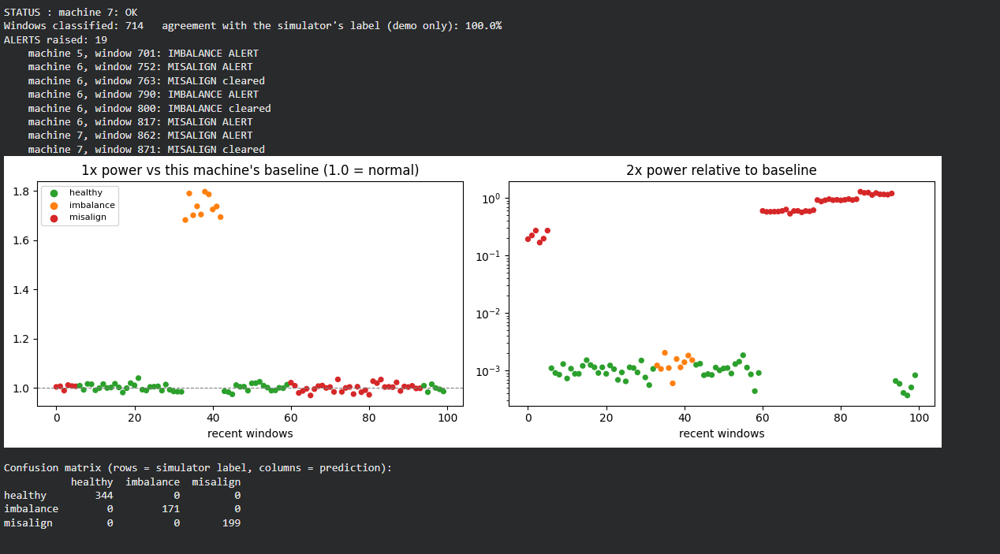
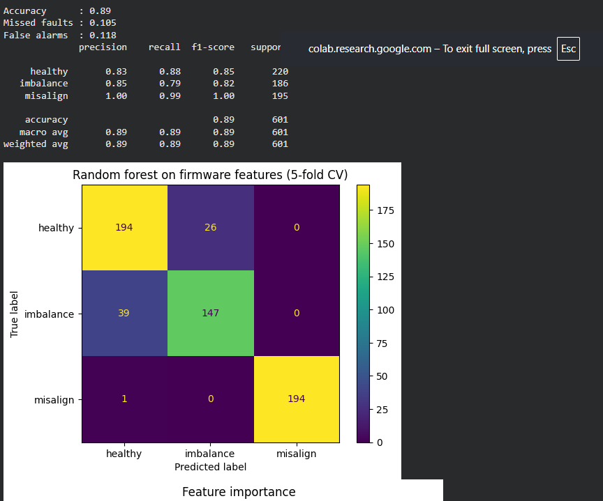

# Vibration-based Predictive Maintenance (ECE + CS)

An end-to-end edge-monitoring prototype: a simulated ESP32 node computes vibration features on the device, publishes them over MQTT, and a Python service classifies machine health and raises alerts.

Built to combine embedded/signal-processing work (ECE) with data pipelines and machine learning (CS).

## Architecture

Machine vibration -> sensor model -> on-device features (RMS, kurtosis, FFT band powers) -> MQTT (HiveMQ public broker) -> Python subscriber -> random forest -> live status and alerts

## What was built

1. **Simulation (MATLAB and Python):** synthetic vibration for healthy, imbalance, misalignment and bearing-fault conditions, with a sensor model (offset, clipping, 12-bit quantization).
2. **Real data (CWRU bearing dataset):** envelope analysis finds the inner-race and outer-race fault frequencies in real recordings.
3. **ML on simulated data:** random forest, anomaly detector trained on healthy data only, and per-machine baseline calibration.
4. **Firmware (Wokwi, ESP32):** FFT, features and MQTT publishing, with per-machine calibration in the firmware itself.
5. **Live monitor (Colab):** classifies each incoming window and raises an alert after 3 consecutive fault windows.

## Key results

- **Simulation, random forest, 5-fold CV:** 87.8%. Most errors were between healthy and mild imbalance.
- **Per-machine baseline (simulation, held-out machines):** false alarms fell from 12.7% to 2.7%, missed faults from 9.2% to 3.8%.
- **CWRU real data (leave-one-load-out):** envelope features alone gave 96.2% mean accuracy. Inner-race and outer-race faults were detected reliably, while ball faults were the hardest class.
- **Firmware features, held-out machines:** raw features gave 89.2% accuracy with 23.6% false alarms. Calibrated features gave 99.8% with 0% false alarms. A random split of the same raw features gave 98.6%, which shows how much random splits inflate results.

## Limitations (please read)

- CWRU is a well-known easy benchmark with one bearing type and one sensor location. Perfect scores on it do not show the method works on any machine. One feature set reached 100% there, but because each condition has only one recording per load, I could not rule out that the model recognized recordings and not faults.
- In the firmware experiment, simulated machines differ only in baseline level, sensor gain and noise, which is exactly what calibration removes. Real machines differ in more ways, so expect a smaller gain.
- Calibration assumes the machine is healthy during its first 20 windows.
- The ESP32 signal in Wokwi is synthesized. Wokwi's virtual accelerometer cannot vibrate. Real hardware needs `genWindow()` replaced with sensor reads.
- Cheap accelerometers such as the MPU6050 cannot capture the 2-5 kHz band used for bearing envelope analysis, so the live node covers imbalance and misalignment only.
- The public MQTT broker is for demos only.

## Repository layout

- `matlab/` simulation, CWRU exploration and evaluation scripts
- `notebooks/` Python notebooks (simulation, ML, data collection, training, live monitor)
- `firmware/` Wokwi sketch for the ESP32
- `data/` small feature tables (the raw CWRU files are not included)
- `models/` trained model for the live monitor
- `docs/` screenshots

## How to reproduce

1. CWRU data: download the files listed in `data/README.md` from the Case Western Reserve University Bearing Data Center.
2. MATLAB: run the scripts in `matlab/` in the order described there.
3. Firmware: paste `firmware/sketch.ino` into a new ESP32 project at wokwi.com, and keep only `PubSubClient` in `libraries.txt`. Change the MQTT topic to your own unique string.
4. Live monitor: run the notebook in `notebooks/` while the simulation is running.

## Screenshots

## Author

[your name]
